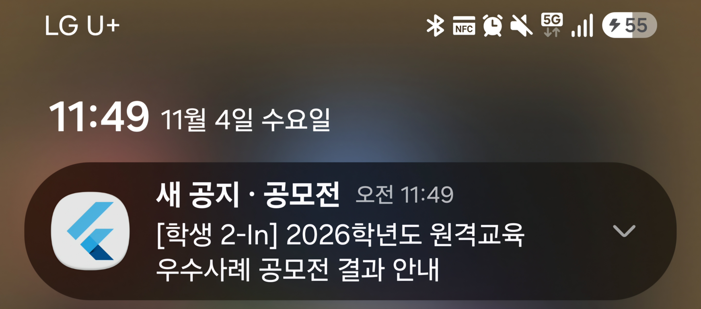

# 10주차 개발일지

**📅 날짜**: 2026.11.03 ~ 2026.11.10

| 진행 항목 | 결과 | 메모 |
|---|---|---|
| 키워드 매칭 → 크롤러 연결 | **완료** | 통합 테스트 5개 |
| FCM 토큰 등록 (앱 → 서버) | **완료** | 실기기에서 토큰 발급·저장 확인 |
| FCM 푸시 발송 (서버) | **완료** | Firebase Admin SDK, **실기기 수신 확인** |
| 알림 이후 사용성 | **완료** | 목록 자동 갱신, 알림 탭 → 원문 열기 |
| 죽은 토큰 정리 | **완료** | 앱 삭제 기기로 확인 |
| 이미지 본문 잘림 | **완료** | 앱 안 WebView + 이미지 폭 맞춤·확대 허용 |
| 미구현 UI 채우기 | 완료 | 방해 금지 화면, 내 키워드 공지 목록, 종 아이콘 점 |
| 캘린더 (기간 추출) | 설계 | 방법 비교, AI 추출 검토 |
| 파싱 붕괴 실환경 확인 | **미완료** | 알림 흐름을 먼저 하기로 하고 이월 |

---

## 1. 전체 흐름: 새 공지가 폰 알림이 되기까지

```
크롤러(1시간마다) → 새 공지 저장 → 키워드·학과 매칭 → FCM 발송 → 폰 알림
                                                                 │
                         알림 탭 → 해당 공지 원문 열기 ◀──────────┘
                         앱 복귀 → 목록 자동 갱신
```

- 앱이 **요청할 때만** 서버가 응답했습니다. 이번에 서버가 **먼저 알려주는** 흐름이 생겼습니다.

---

## 2. 키워드 매칭을 크롤러에 연결

| 항목 | 내용 |
|---|---|
| 시점 | 크롤에서 새로 저장된 공지만 매칭 |
| 대상 | 전체공지 → 키워드 맞는 모든 기기 / 학과공지 → 키워드 맞고 그 학과인 기기 |
| 첫 수집 | **매칭 건너뜀** |
| 실패 처리 | 매칭·발송이 실패해도 크롤·저장·crawl_log는 정상 진행 |
| 테스트 | 통합 테스트 5개 (첫 수집, 대상 기기만 선택, 새 공지 없음, 대상 없음, 발송 실패) |

- 설계 판단: 게시판을 처음 수집하면 이미 있던 공지 수백 개가 전부 "새 공지"가 됩니다. 그대로 매칭하면 **알림 폭탄**이 되므로, 게시판의 첫 수집은 저장만 하고 매칭하지 않습니다.

---

## 3. FCM 푸시

| 단계 | 내용 |
|---|---|
| 앱 | 알림 권한 요청 → FCM 등록 토큰 발급 → `PATCH /api/devices/{id}/fcm-token` |
| 토큰 갱신 | 앱을 켤 때마다, 토큰이 바뀔 때마다 다시 보냄 |
| 서버 발송 | Firebase Admin SDK (Java). 기기별로 따로 보내 **한 기기 실패가 다른 기기를 막지 않음** |
| 알림 내용 | 제목 `새 공지 · 키워드`, 내용은 공지 제목, 데이터로 공지 id·URL |
| 켜고 끄기 | `FCM_ENABLED` 환경변수. 끄면 발송 대신 로그만 남김 |
| 테스트 | 발송 3개 (토큰 있는 기기만 발송, 실패 격리, 대상 없음) |

- 보안: 서비스 계정 키는 **프로젝트 밖**(`~/secrets`)에 두고 경로만 환경변수로 넘깁니다. 토큰은 로그에 남기지 않습니다. `google-services.json`과 키 파일은 Git에서 제외했습니다.

### 실기기 검증 (USB 연결)

1. 키워드가 제목에 들어간 공지 1건을 DB에서 삭제
2. 앱을 백그라운드로 보내고 수동 크롤 실행
3. 서버 로그: `Saved new notice` → `Keyword matching done ... noticesWithTargets=1` → `Push sent`
4. 폰에 알림 도착



---

## 4. 이미지 본문 잘림

| 항목 | 내용 |
|---|---|
| 증상 | 이미지로 된 본문의 오른쪽이 잘리고 확대·축소가 안 됨 |
| 원인 | 학교 상세 페이지가 PC 기준 **고정 폭 이미지** + **확대 금지**(`user-scalable=no`) |
| 해결 | 인앱 브라우저 → **앱 안 WebView**. 페이지가 뜬 뒤 넓은 이미지만 화면 폭에 맞추고 확대 허용 |
| 텍스트 본문 | 글자는 건드리지 않아 그대로. 텍스트+이미지 본문도 이미지만 맞춰짐 |
| 기타 | 상단바(제목, 새로고침, 브라우저로 열기), 첨부파일·전화 링크는 외부 앱으로 |


- 앞으로 서버가 본문을 직접 수집하게 되면(캘린더 작업) 앱 자체 상세 화면으로 확장할 수 있습니다. 그때도 WebView는 "원문 보기"로 남깁니다.

---

## 5. 미구현 UI 채우기

| 화면 | 내용 |
|---|---|
| 방해 금지 시간 | 켜기/끄기, 시작·종료 시각 선택 (앱에 저장) |
| 내 키워드 공지 | 홈 "전체보기"·종 아이콘 → 페이지 단위 전체 목록 |
| 종 아이콘 | 안 읽은 키워드 공지가 있을 때만 빨간 점 |

- 방해 금지는 아직 **화면 설정만** 있고 서버 발송에는 반영되지 않습니다.

---

## 6. 고민: 캘린더 (공지 기간 추출)

**목표**: 본문에 적힌 기간(예: `2026. 11. 2.(월) ~ 11. 22.(일)`)을 뽑아 캘린더에 표시하고, 없으면 표시하지 않기

**어려운 점**
- 공지마다 양식이 다름 (기간의 위치, 표기, 라벨이 제각각)
- 본문이 **텍스트 / 이미지 / 텍스트+이미지** 세 가지
- 지금 크롤러는 목록만 읽어서 **본문이 없음** → 상세 페이지 수집이 먼저 필요

**검토한 방법**

| 방법 | 장점 | 한계 |
|---|---|---|
| 제목에서 추출 | 지금 데이터로 가능 | 제목에 기간이 있는 공지는 일부 |
| 정규식 | 빠르고 무료, 설명 가능 | 처음 보는 표현을 놓침, 이미지 불가 |
| 표 구조 파싱 | 라벨·값이 나뉘어 정확 | 표를 안 쓰는 공지는 불가 |
| OCR + 정규식 | 이미지 대응 | 오인식이 많고 무거움 |
| **AI(비전 모델) 추출** | 양식·이미지 모두 대응 | 날짜를 지어낼 수 있음, 비용 |

**방향: AI 추출 + 검증**
- 응답을 `{기간 라벨, 시작, 끝, 근거 문구}` 형식으로 고정하고, 기간이 없으면 null 허용
- 텍스트 공지는 **근거 문구가 실제 본문에 있는지 대조**, 이미지 공지는 "추정"으로 표시
- 날짜 상식 검사 (끝이 시작보다 빠름, 게시일과 너무 멂 등)
- 사용자가 직접 수정 가능

**확장성 (학교가 늘어나면?)**
- AI는 **공지당 한 번만** 호출하고 결과를 저장 → 비용은 **사용자 수가 아니라 새 공지 수**에 비례
- 줄이는 방법: 정규식으로 확실한 건 AI 생략, 두 게시판에 같은 공지가 올라오면 결과 재사용, 학생 일정과 무관한 공지 제외, 하루 호출 상한
- 크롤과 분리된 대기열에서 처리하므로 호출 한도에 걸려도 늦어질 뿐 멈추지 않음

---

## 7. 검증 현황

| 항목 | 상태 |
|---|---|
| 실기기 푸시 수신 | 확인 |
| 알림 탭 → 원문 열기 | 확인 |
| 목록 자동 갱신 | 확인 |
| 죽은 토큰 정리 로그 | 확인 |
| 이미지 본문 잘림 해결 | 확인 |

---

## 8. 다음 계획

1. **파싱 붕괴 실환경 확인**: 게시판 URL을 다른 구조의 페이지로 바꿔 `PARSE_COLLAPSE` 기록과 Discord 경고 확인
2. **중복 푸시 방지**
3. **캘린더**: 공지 20개로 AI 추출 정확도 실험 → 결과를 보고 구현
4. **설정 기반 파서**: 사이트 구조가 바뀌면 코드 대신 설정만 수정


