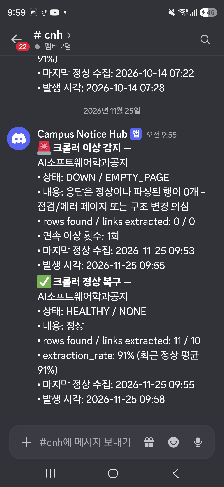

# 13주차 개발일지

**📅 날짜**: 2026.11.18 ~ 2026.11.24

| 진행 항목 | 결과 | 메모 |
|---|---|---|
| 파싱 붕괴 실환경 확인 | **완료** | 일부러 고장을 내서 재현 → Discord 경보, 복구도 자동 감지 |
| 설정 기반 파서 | **완료** | 사이트 구조가 바뀌면 코드 수정·재배포 없이 읽기 규칙만 교체 |
| 중복 푸시 방지 | **완료** | 같은 공지가 두 게시판에 올라와도, 다시 수집돼도 알림은 1번 |
| 알림 몰아치기 방지 | **완료** | 3건 이상은 "새 공지 N건" 하나로, 3일 지난 공지는 알리지 않음 |
| 마감 하루 전 알림 | **완료** | 저장한 공지의 마감 전날 1번 |
| 방해 금지·알림 끄기 서버 반영 | **완료** | 방해 금지 중 알림은 버리지 않고 대기했다가 발송 |
| 기간 추출 개선 | **완료** | 재시도 간격 늘리기, 저장하면 바로 분석 |
| 기기 인증 | **완료** | 남의 기기 번호로 키워드·저장 목록을 못 건드리게 |
| 서버 검색 · 문의하기 | **완료** | 전체 공지 제목 검색, 설정에 문의 메일 |
| **서버 배포** | **완료** | Oracle Cloud 무료 서버 + HTTPS → 폰이 어디서든 접속 |
| DB 자동 백업 | **완료** | 매일 새벽, 7일치 보관 |

---

## 1. 파싱 붕괴

### 실환경 확인

크롤러 자가진단이 실제 학교 사이트에서도 동작하는지, **일부러 고장을 내서** 확인했습니다.

| 시각 | 한 일 | 결과 |
|---|---|---|
| 09:55 | 학과 게시판 주소를 학교 메인 페이지로 바꾸고 크롤 | 응답은 정상(200)인데 공지 0개 → `DOWN / EMPTY_PAGE` 경보 |
| 09:58 | 원래 주소로 되돌리고 크롤 | 11행 중 10개 읽음(91%, 평소 평균과 같음) → `HEALTHY` 복구 알림 |



- 에러가 나지 않는 고장(페이지는 열리는데 목록이 비어 있음)이라 예외 처리만으로는 못 잡는 경우입니다.
- "평소에 몇 개 읽혔는지" **기준선과 비교**하기 때문에 잡을 수 있었습니다.

### 설정 기반 파서

지금까지는 고장을 **감지만** 하고, 고치려면 코드를 고쳐 다시 배포해야 했습니다. 그래서 **읽는 규칙을 코드에서 DB로** 뺐습니다.

| 규칙 | 기본값 (우리 학교) |
|---|---|
| 행 | `tr` |
| 링크 | `td.td-subject a` |
| 제목 | `td.td-subject a strong` |
| 날짜 / 형식 | `td.td-date` / `yyyy.MM.dd` |
| 공지 번호 | `/(\d+)/artclView\.do` |

| 관리자 API | 하는 일 |
|---|---|
| `GET /boards/{id}/parser` | 지금 규칙 보기 |
| `POST /boards/{id}/parser/test` | 새 규칙으로 **저장 없이 미리 읽어 보기** |
| `PUT /boards/{id}/parser` | 저장 (**하나도 못 읽으면 저장 거부**) + 기준선 다시 학습 |
| `DELETE /boards/{id}/parser` | 기본 규칙으로 되돌리기 |

- 미리 읽기 → 확인 → 저장 순서라, 잘못된 규칙으로 게시판을 망가뜨릴 일이 없습니다.
- 다른 학교 게시판도 **코드 수정 없이 규칙만 넣어** 추가할 수 있습니다. (처음 목표였던 학교 확장과 연결)

---

## 2. 알림

이번 주 알림 기능은 전부 **보내기 직전의 관문 하나(`PushDispatchService`)**에 모았습니다. 새 공지 알림이든 마감 알림이든 같은 규칙을 거칩니다.

```
새 공지 / 마감 전날
      │
      ▼
① 이미 보낸 알림인가? ────── 예 → 보내지 않음
② 3일 넘게 지난 공지인가? ── 예 → 건너뜀  (SKIPPED)
③ 알림을 꺼 뒀나? ────────── 예 → 건너뜀  (SKIPPED)
④ 방해 금지 시간인가? ────── 예 → 대기    (QUEUED) → 끝나면 1분 안에 발송
      │ 모두 아니오
      ▼
⑤ 발송 (SENT) ── 한 기기에 새 공지 3건 이상이면 "새 공지 N건" 하나로 묶음
```

- 모든 결정을 `push_log` 테이블에 남깁니다. "왜 알림이 안 왔지?"를 DB 한 줄로 설명할 수 있습니다.

### 중복 기준을 무엇으로 할까

| 선택지 | 문제 |
|---|---|
| 공지 번호(id) | 같은 공지가 전체공지·학과공지에 둘 다 올라오면 번호가 달라서 2번 감 |
| **공백을 없앤 제목의 해시** | 게시판이 달라도 같은 공지면 같은 값 → **선택** |

- `(기기, 중복 키)`에 **DB 유니크 제약**을 걸어, 크롤 두 개가 동시에 돌아도 1번만 저장·발송됩니다.
- 마감 알림은 `공지 번호 + 마감일`이 키입니다. 마감일이 바뀌면 다시 알립니다.

### 마감 하루 전 알림

- 저장한 공지 중 **내일 마감**인 것을 찾아 "내일 마감 · 신청기간" 알림을 보냅니다.
- 기간이 확실한 공지(CONFIRMED·ESTIMATED)만 대상입니다. 확실하지 않은 날짜로는 알리지 않습니다.
- **9시~21시 매시 정각**에 확인합니다. 9시에 한 번만 하면, 낮에 저장한 "내일 마감" 공지나 9시에 서버가 꺼져 있던 날을 놓칩니다. 매시간 확인해도 중복 키 덕분에 **알림은 하루 1번**입니다.

### 방해 금지 · 알림 끄기

- 앱 설정에만 있던 값을 서버에 보냅니다 (`PUT /api/devices/{id}/notification-settings`).
- 방해 금지 중 알림은 버리지 않고 **대기 → 끝나는 시각 이후 발송**합니다. 22:00~08:00처럼 자정을 넘는 구간도 처리합니다.

---

## 3. 기간 추출 개선

| 바꾼 것 | 전 | 후 | 이유 |
|---|---|---|---|
| 저장한 공지 분석 | 다음 주기까지 대기 | **저장하는 순간 바로** | 저장하고 캘린더를 열면 바로 기간이 보이도록 |

---

## 4. 기기 인증

**문제**: 앱은 로그인이 없고, API가 `/api/devices/3/keywords`처럼 **기기 번호**로 동작했습니다. 번호는 1, 2, 3… 순서라 **남의 번호를 넣으면 남의 키워드·저장 목록을 보고 바꿀 수 있었습니다.**

| 선택지 | 판단 |
|---|---|
| 회원가입·로그인 | 공지 알림 앱에 가입은 과하고, 개발량도 큼 |
| **기기 UUID를 비밀값으로** | 앱 설치 때 만든 무작위 UUID(추측 불가)를 요청마다 보냄 → **선택** |

- 앱: 모든 요청에 `X-Device-Uuid` 헤더를 자동으로 붙입니다. (dio 인터셉터)
- 서버: 기기 번호가 들어간 모든 API에서 "이 번호의 주인이 이 UUID인가"를 확인합니다. 기기가 없으면 404, 주인이 아니면 403.
- 비교는 **상수 시간 비교**(`MessageDigest.isEqual`)로 합니다. 비교에 걸리는 시간 차이로 값을 알아내는 공격을 막습니다.

---

## 5. 서버 배포

### 구조

```
폰 ──HTTPS──▶ cnh-alarm.duckdns.org  (Caddy: 인증서 자동 발급·갱신)
                    │   /api/admin/*, /actuator/* → 404 (바깥에서 차단)
                    ▼
             Spring Boot (127.0.0.1:8080) ──▶ MariaDB (127.0.0.1:3306)
                    ├─ 크롤 (1시간마다) ──▶ 학교 사이트
                    ├─ 기간 추출 ─────────▶ Gemini
                    └─ 푸시 ──────────────▶ FCM ──▶ 폰

                    Oracle Cloud 도쿄, 무료 서버 1대
```

### 결정과 이유

| 고민 | 선택 | 이유 |
|---|---|---|
| 클라우드 | **Oracle Cloud** (vs AWS) | AWS 무료는 6개월(또는 크레딧 소진)까지, Oracle은 계속 무료 |
| 서버 크기 | **Micro (메모리 1GB)** | 무료 ARM(6GB)은 자원 부족으로 만들기 어려움. 사용자·작업량이 작아 1GB로 충분 → 스왑 2GB + Java 메모리 384MB로 맞춤 |
| 지역 | 도쿄 | 기존 계정의 지역. 해외 IP를 학교 사이트가 막는지 **먼저 확인** → 정상 |
| HTTPS | **Caddy + DuckDNS** | 무료 도메인 + 인증서 발급·갱신 자동 |
| 실행 | systemd | 서버 재부팅·프로그램 오류 시 자동으로 다시 켜짐 |
| 배포 | `deploy.sh` 한 줄 | **테스트 → 빌드 → 업로드 → 재시작**. 테스트가 실패하면 배포되지 않음 |

### 보안

| 층 | 조치 |
|---|---|
| 통신 | HTTPS만. 출시용 앱은 평문 HTTP 차단 (개발 빌드만 허용) |
| 열린 포트 | 80·443만 (클라우드 방화벽 + 서버 방화벽 두 겹). Spring·DB는 서버 안에서만 접속 |
| 관리자 API | 바깥에선 Caddy가 404, 서버 안에서도 48자리 무작위 토큰 필요 |
| 비밀값 | DB 비밀번호·토큰은 서버가 무작위로 생성해 `cnh.env`(주인만 읽기)에만 보관. **Git 기록 전체 검사 → 비밀값 0건** |
| 실행 계정 | 권한이 적은 전용 계정 `cnh`로 실행 → 뚫려도 피해 범위가 좁음 |
| SSH | 키로만 로그인 (비밀번호 로그인 꺼짐) |
| 업데이트 | 우분투 보안 업데이트 자동 설치 |

- 인증서를 받고 **1~2분 만에** 인터넷 스캐너가 Jira 취약점 경로(`.../META-INF/maven/com.atlassian.jira/...`)를 찔러 봤습니다. 서버는 404로 거부했습니다. 공개 서버는 켜자마자 공격 시도를 받는다는 걸 직접 확인했습니다.

---

## 6. 배포하고 나서야 보인 문제들

내 맥에서는 안 보이던 문제가 실제 서버에서 나타났습니다.

### ① 첫 크롤이 "게시판 0개" (경쟁 상태)

```
11:18:31.137  Seed finished ... boardsCreated=2   ← 게시판 2개 등록
11:18:31.249  Scheduled crawl started             ← 0.1초 뒤 첫 크롤 시작
11:18:31.436  Found 0 active board(s)             ← 게시판이 안 보임
11:18:31.632  Seeded 6 preset keyword(s)          ← 등록 트랜잭션은 여기서야 끝남(커밋)
```

- **원인**: 게시판·키워드 등록이 **한 트랜잭션**이라 키워드까지 끝나야 DB에 저장(커밋)되는데, 첫 크롤이 그 0.2초 사이에 끼어들었습니다. 빠른 맥에서는 등록이 먼저 끝나 드러나지 않았고, 느린 서버에서 처음 나타났습니다. 다음 크롤은 1시간 뒤라 그동안 공지가 0개였습니다.
- **해결**: 크롤 스케줄러가 **앱 준비 완료 신호(`ApplicationReadyEvent`)**를 받을 때까지 기다리게 했습니다. 재배포 후 `Found 2 active board(s)` 확인, 테스트도 추가했습니다.

### ② 공지 번호가 달라져 저장 목록이 꼬일 뻔함

- 앱은 저장한 공지를 **내 맥 서버의 공지 번호**로 기억합니다. 새 서버는 공지를 처음부터 모아서 번호가 달랐습니다. (서버의 1번 = 전혀 다른 공지)
- **해결**: 맥 DB의 공지 79건을 **번호 그대로** 서버로 옮겼습니다. 저장 목록이 정확히 이어지고, Gemini가 이미 분석한 기간 결과도 그대로 살려 **API 호출을 아꼈습니다.**

---

## 7. DB 자동 백업

| 항목 | 내용 |
|---|---|
| 주기 | 매일 새벽 4:30 (그 시각에 꺼져 있었으면 켜진 뒤 바로) |
| 보관 | 서버에 7일치 (하루 약 12KB) |
| 실패 시 | Discord 경보 |
| 서버가 통째로 사라지면 | `pull-backups.sh`로 맥에 사본 |

- 서비스를 멈추지 않고 백업합니다 (`--single-transaction`).
- 백업 스크립트와 파일은 관리자(root)만 접근 → 서버 프로그램 계정이 뚫려도 백업은 안전합니다.

---

## 8. 다음 계획

1. 요청 횟수 제한 (기기 등록 남용 방지)

-
-
-
-
-
-
-
-
-
-
-

