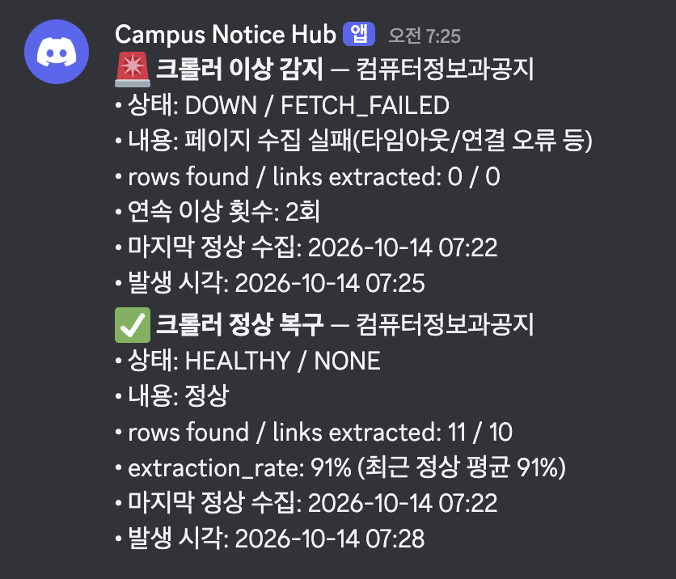

# 7주차 개발일지

**📅 날짜**: 2026.10.06 ~ 2026.10.13

| 이번주 진행 항목 | 결과 | 메모 |
|---|---|---|
| crawl_log 기록 | 완료 | 게시판 1개 × 1사이클마다 한 행 |
| 급락 판단 로직 | 완료 | 고정 임계치 대신 게시판별 '평소 값'과 비교 |
| Discord 알림 | **완료** | 장애·복구 알림을 실제 채널에서 수신 (스크린샷) |
| 구조 변경 감지 | 일부 완료 | 접속 실패는 실제 서버에서 확인, 파싱 붕괴는 가짜 HTML 테스트로 검증 |
| 스크랩 기능 | 완료 | 등록·취소·목록 API |

---

## 1. 문제: 조용한 실패

| 상황 | 응답 | 에러 | 새로 저장된 글 | **읽어낸 글** | 기록 |
|---|---|---|---|---|---|
| 새 글이 있는 날 | 200 | 없음 | 1~3건 | 10 | success = true |
| 새 글이 없는 날 | 200 | 없음 | 0건 | 10 | success = true |
| **사이트 개편으로 파싱 실패** | 200 | 없음 | 0건 | **0** | success = true |

- **"읽어낸 글"** (`links_extracted`)**로 판단합니다. 이미 저장된 예전 글도 매번 읽기 때문에 새 글과 상관없이 거의 일정해야 정상입니다.
- 크롤링 프로세스는 최신 1개 페이지 대상의 단일 스크래핑 방식으로, 수집 건수는 대상 페이지 내 게시물 수와 동일하게 유지되는 것을 정상 기준으로 정의했습니다.
- 새로 저장한 글 수(`newly_saved_count`)는 나중에 푸시 알림에 씁니다.

---

## 2. 한 사이클의 흐름 (1시간마다 반복)

```
 1. 수집  게시판 HTML을 가져온다
 2. 파싱  공지 목록(제목·링크)을 뽑는다
 3. 저장  새 글만 DB에 저장한다
 ───────── 여기까지 기존 기능 ─────────
 4. 판정 ★ 평소 값과 비교해 정상인지 본다
 5. 알림 ★ 이상이면 Discord로 알린다
 6. 기록 ★ 결과를 crawl_log에 남긴다
```

---

## 3. 0건 규칙

행이 5개 이상 보이는데 읽어낸 글이 0건이면 학습 기간에도 바로 이상으로 판단합니다. 평균 비교는 그 규칙이 못 잡는 경우를 위한 보강입니다.

| 상황 | 읽어낸 글 0건 규칙 | 평소 대비 비교 |
|---|---|---|
| 새 글이 없는 날 (10 → 10) | 정상 | 정상 |
| 완전히 못 읽음 (10 → 0) | 감지 | 감지 |
| **일부만 읽힘 (10 → 3)** | **놓침** | **감지** |

- 평소 대비 비교는 평소 값이 12개 쌓인 **학습 기간이 끝난 뒤부터** 동작합니다.
- 게시판마다 평소 개수가 달라서 기준을 사람이 정할 수 없으니, **게시판별 평소 값을 스스로 학습**합니다.
- 단, 일부만 읽히는 파손은 실제로 겪은 적이 없고 50% 기준도 검증 전입니다. 운영하면서 보정할 계획입니다.

---

## 4. 판정 규칙

| 구분 | 상황 | 알림 |
|---|---|---|
| 재현되는 문제 | 차단(401·403·429), 빈 페이지, 파서 예외, 평소의 50% 미만으로 급락 | **즉시** |
| 일시적일 수 있는 문제 | 접속 실패, DB 저장 실패 | **2회 연속일 때** |
| 평소 값 12개 미만 | 학습 기간 | 보류 (단, 행 5개 이상인데 읽어낸 글 0건이면 즉시) |

설계 판단 세 가지: ① 정상 기록만 평소 값에 쓴다 (고장이 새 정상이 되지 않게) ② 알림 상태를 DB 기록에서 계산한다 (재시작해도 중복·누락 없음) ③ 전송 실패는 '보냄'으로 기록하지 않고 다음 사이클에 재시도한다.

---

## 5. 실제 환경 검증

| 확인한 것 | 결과 |
|---|---|
| 실제 크롤링 | `rows found 11 / links extracted 10`, 게시판당 약 150~420ms |
| 학습 → 정상 전환 | 12번째까지 `LEARNING`, **13번째부터 `HEALTHY`** |
| 재시작 후 | 첫 사이클부터 `HEALTHY` 유지 (DB 기록에서 복원) |
| **Discord 알림** | 수집 **2회 연속 실패 → 장애 알림**, 정상 복귀 → **복구 알림**을 실제 채널에서 수신 → *(스크린샷 첨부)* |
| 자동 테스트 | **56개 전부 통과** (파싱 붕괴·급락 등은 가짜 HTML로 검증) |


---

## 6. 한계

- **스케줄러가 죽으면 알림도 멈춥니다.** 외부 모니터링이 필요합니다.
- 파싱 붕괴 판정은 **가짜 HTML로 검증**했고, 실제 사이트 개편은 겪어 본 적이 없습니다. 실제 서버에서는 접속 실패 시나리오만 확인했습니다.
- 새 게시판 등록·기준 초기화 직후 **12사이클(약 12시간)** 동안은 일부만 읽히는 파손을 못 잡습니다.
- 페이지당 글 수 설정이 바뀌면 급락으로 오탐할 수 있습니다 (`reset-baseline`으로 해결).

---

## 7. 다음 주 계획

**다음 주 (3가지)**
1. 파싱 붕괴 실환경 확인: 게시판 주소를 구조가 다른 정상 페이지(200 응답)로 잠시 바꿔 알림 확인 후 원복
2. 초기 데이터 시딩 (학교·학과·게시판)
3. 신규 공지와 구독 키워드 매칭 로직 + 테스트 (발송 제외)

**이후**: 설정 기반 파서(`board_crawl_config`), FCM 연동, Flutter 앱


