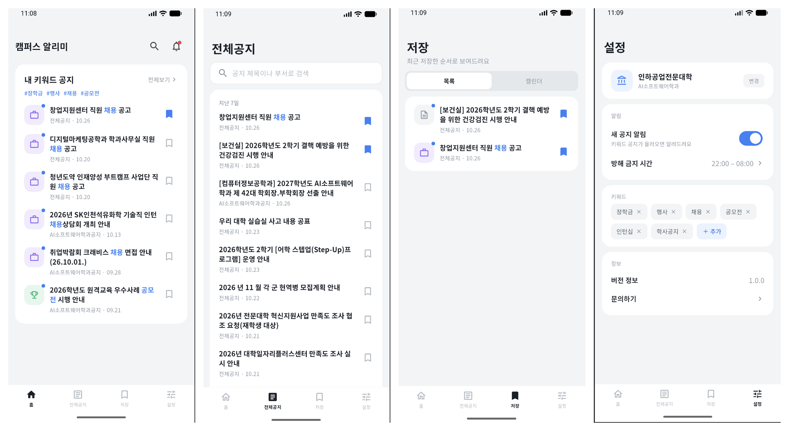
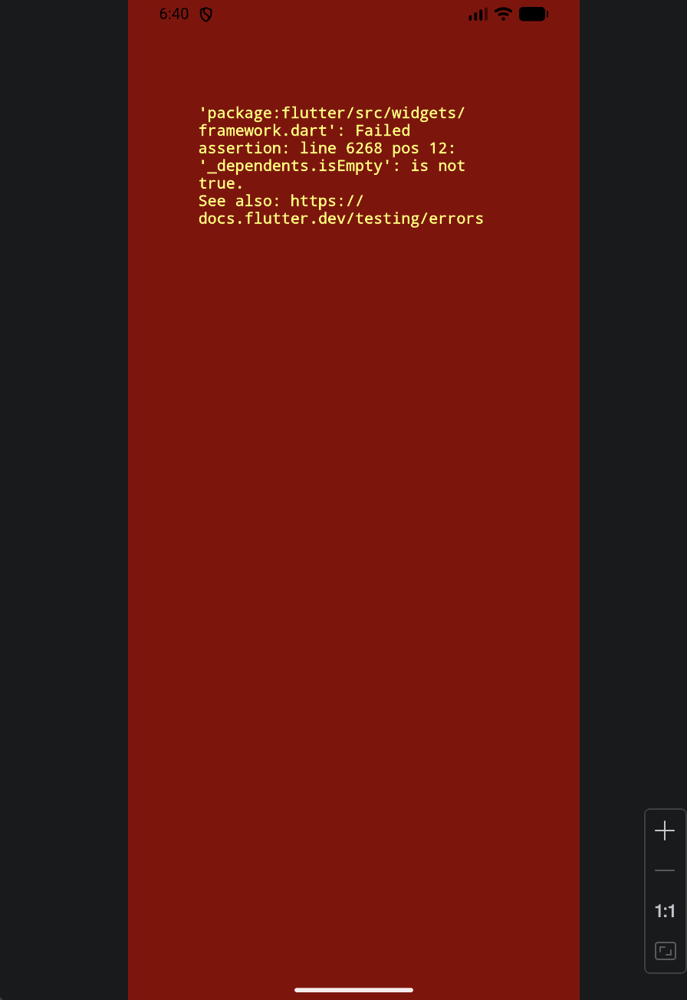

# 8주차 개발일지

**📅 날짜**: 2026.10.20 ~ 2026.10.27 *(시작·종료일 확인해서 수정)*

| 이번주 진행 항목 | 결과 | 메모 |
|---|---|---|
| 초기 데이터 시딩 | **완료** | JSON 설정 + 멱등 로더, 테스트 8개, 실제 DB 반영·수집 확인 |
| 키워드 매칭 로직 | **완료** | 서비스·테스트 9개 (발송 제외, 크롤러 연결 전) |
| 파싱 붕괴 실환경 확인 | **미완료** | 지난주 계획. 다음 주로 이월 |
| Flutter UI | 완료 | 4개 화면, 실제 폰에서 화면 확인 |
| 앱 ↔ 서버 연결 | 일부 완료 | 코드 완료, 신규 서버 테스트·기기 최종 확인 전 |

---

## 1. 초기 데이터 시딩

| 항목 | 내용 |
|---|---|
| 방식 | `seed/universities.json` 설정 파일 + `SeedDataLoader` |
| 게시판 식별자 | **crawlUrl** (이미 있으면 건너뜀 → 여러 번 실행해도 중복 없음) |
| 학교·학과 | 새 게시판이 있을 때만 필요한 만큼 생성 |
| 검증 | 이름·URL이 비어 있으면 거부 |
| 테스트 | 8개 통과 (`seed.enabled=false`로 테스트 환경에서는 실행 안 함) |

- 설계 판단: 처음에는 (학교, URL)로 중복을 판단하려 했습니다. 하지만 DB의 학교 이름이 JSON과 다르면 **같은 게시판이 중복 생성**됩니다. 그래서 URL만으로 판단하도록 바꾸고 테스트를 추가했습니다.

---

## 2. 키워드 매칭 규칙

| 게시판 종류 | 알림 대상 |
|---|---|
| 학교 전체 공지 | 키워드가 맞는 **모든 기기** |
| 학과 공지 | 키워드가 맞고 **해당 학과인 기기만** |

- 키워드가 하나도 없는 기기는 대상이 아닙니다. 대소문자는 구분하지 않고, 제목에 포함되면 맞는 것으로 봅니다.
- 테스트: `KeywordMatcher` 4개, `NoticeMatchService` 5개 통과
- 아직 크롤러에 연결하지 않았습니다. FCM과 함께 다음 단계에서 붙입니다.

---

## 3. 앱: Flutter

| 화면 | 내용 |
|---|---|
| 홈 | 내 키워드에 맞는 공지, 안읽음 점 |
| 전체공지 | 페이지 단위로 더 불러오기, 안 읽은 공지는 볼드 |
| 저장 | 북마크 목록. 캘린더는 "준비 중" |
| 설정 | 학교·학과, 키워드, 알림 |

- 제목 속 키워드는 파랑 볼드로 표시하고, 탭하면 원문을 앱 내 브라우저로 엽니다.
- 확장 대비: 공지 모델의 `startDate`/`endDate`를 nullable로 미리 반영했고, 마감일이 있으면 D-day 배지를 보여줍니다.
- 테마·재사용 위젯(공지 행, 탭바, 설정 행, 세그먼트 버튼)으로 분리했고 폰트는 Noto Sans KR입니다.

---

## 4. 앱 ↔ 서버 연결

| 기능 | 동작 |
|---|---|
| 기기 등록 | 앱 시작 시 UUID로 서버에 등록 (404면 재등록) |
| 키워드 | 직접 입력한 것도 **서버에 저장**. 서버 프리셋은 **추천 칩**으로 표시. X로 삭제 (서버 먼저, 실패하면 안내) |
| 학과 | 설정의 "변경" → `/api/departments` 목록에서 선택 |
| 홈 피드 | 서버 `/api/feed`. 실패하면 전체공지를 받아 로컬에서 필터 |

[Flutter 앱]  ──HTTP 요청(dio)──▶  [Spring 서버]  ──▶  [MariaDB]
   화면·입력   ◀──── JSON 응답 ────   API·비즈니스 로직      공지·기기·키워드
                                       ▲
                              1시간마다 [크롤러]가 학교 사이트에서 수집해 DB에 저장

- 서버에 새로 생긴 API: `GET /api/departments`, `GET /api/devices/{id}/keywords`, `GET /api/keywords?presetOnly=true`

---

## 5. 검증 현황

| 확인한 것 | 결과 |
|---|---|
| 서버 자동 테스트 | 시딩·매칭 추가 후 `BUILD SUCCESSFUL` (73개) |
| 신규 서버 테스트 10개 (키워드 동기화 7, 컨트롤러 3) | **아직 실행 전** |
| `flutter analyze` | 이슈 없음 |
| 실제 폰(USB) 화면 | 4개 화면 표시 확인 |
| 앱 ↔ 서버 연결 | **기기 최종 확인 전** (에뮬레이터 설치 오류로 지연) |
| 파싱 붕괴 실환경 | 미완료 |

---

## 6. 막혔던 점

- 닫히는 중인 다이얼로그가 이미 폐기된 입력 컨트롤러를 참조해서 오류가 났다고 보고, 컨트롤러의 생명주기를 위젯 State에 맞춘 바텀시트로 교체했습니다.

---

## 7. 다음 주 계획

**다음 주 (3가지)**
1. 파싱 붕괴 실환경 확인 : AI소프트웨어학과 게시판 주소를 구조가 다른 200 응답 페이지로 잠시 바꿔 판정·Discord 알림을 확인하고 원복
2. 신규 서버 테스트 10개 통과 + 폰/에뮬레이터에서 앱↔서버 최종 확인
3. 캘린더: 공지 상세 페이지에서 기간(시작~마감)을 추출하는 방식 설계
4. 다른 학교 사이트 1곳을 골라 어떤 신호(상태코드·응답 본문)로 막히는지 확인하고 8번 표에 반영

**이후**: 키워드 매칭을 크롤러에 연결, FCM 푸시, 설정 기반 파서(`board_crawl_config`)

